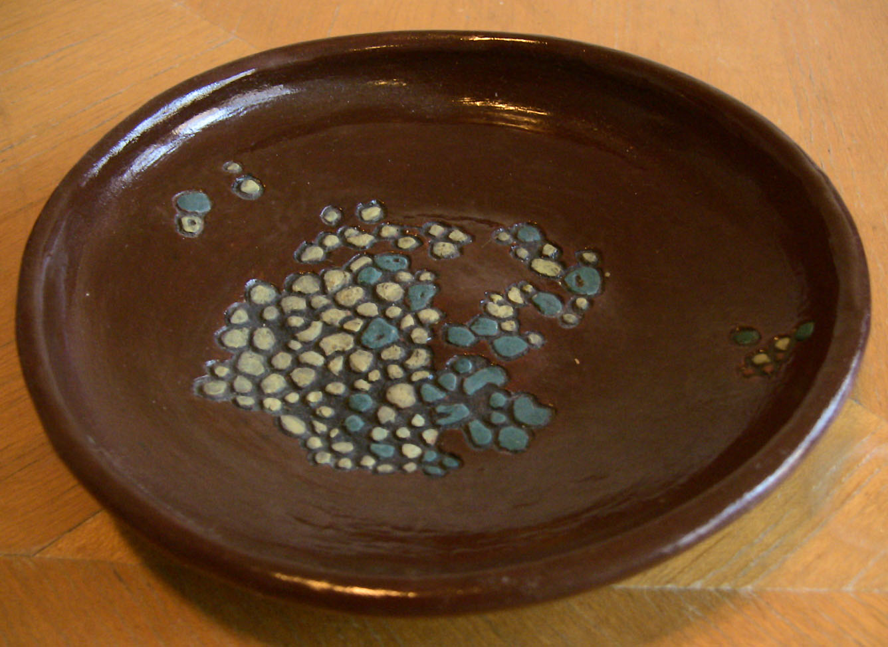
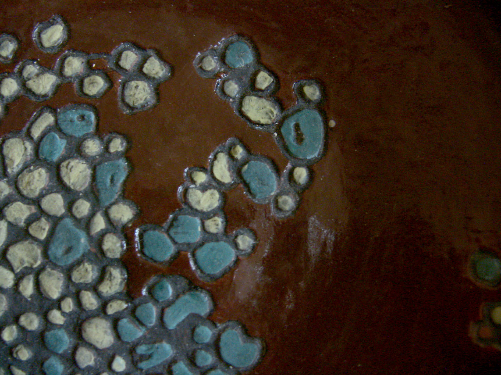
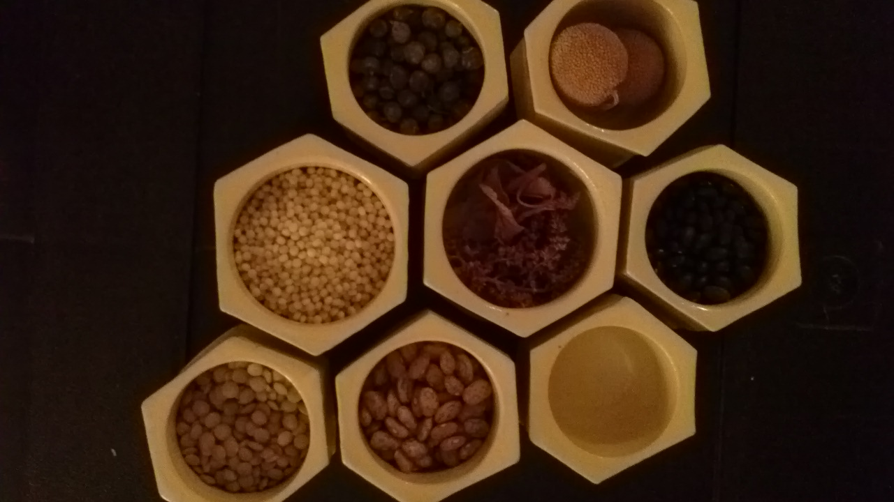
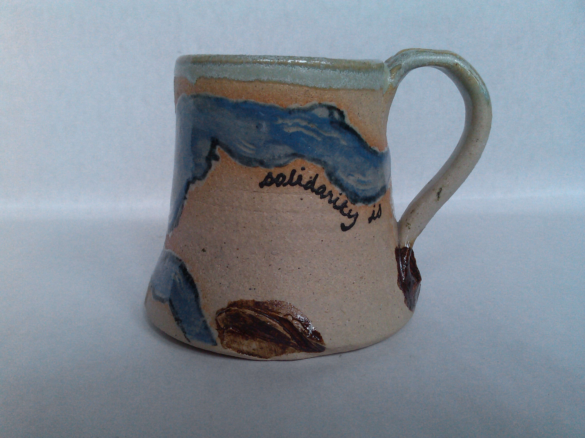
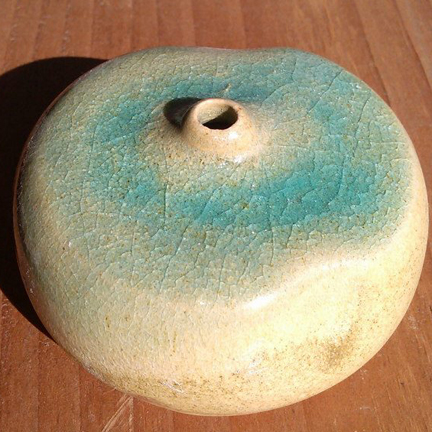
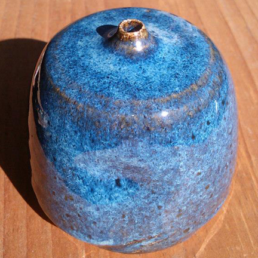
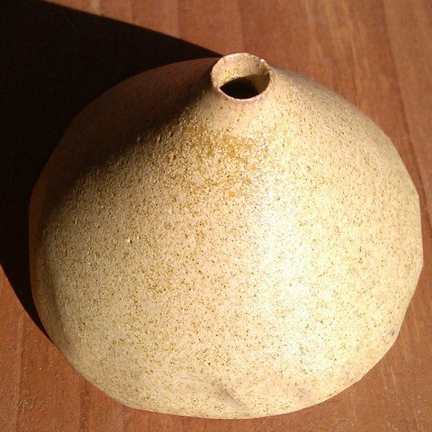

Clay has memory. Wedge it, throw it, cut it-in order to make it useful. When I'm working on a piece, its like a dance, a conversation, between me and the clay body. In the end, it will always be the clay that has the last word revealing every event in the process.

## first plate

## commissioned wedding ceremony gift

## wind chimes

## mugs

## seed pots

