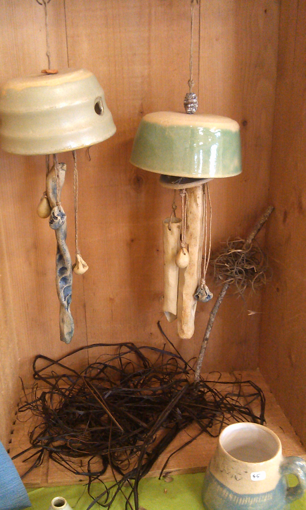
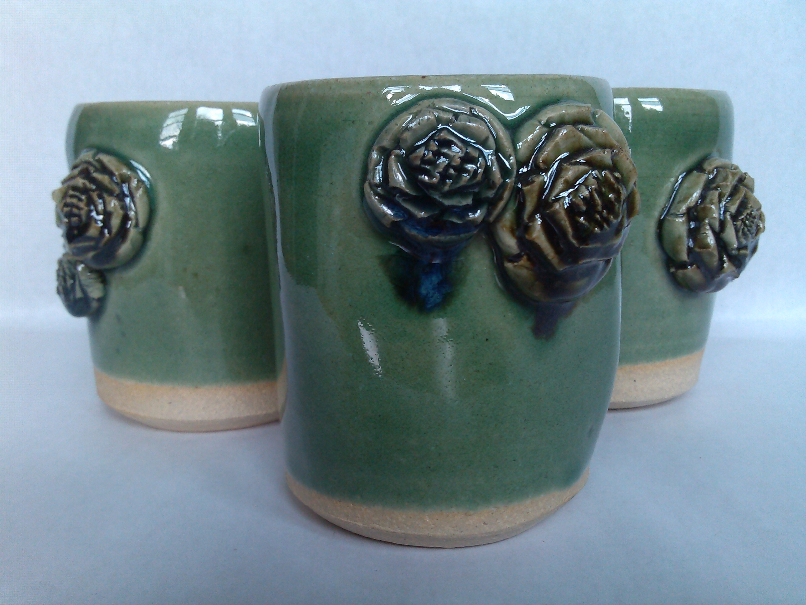

I’m drawn to ceramics for the way it brings attention to touch, time, and the small decisions made by hand. Working with clay is a process of listening as much as shaping: its weight and resistance guide the form, while each mark records a moment in its making.

These pieces hold onto that sense of process. Rather than hiding the handmade, I value the subtle variations that make each object feel individual. The work sits between function and sculpture, inviting a closer look at the forms and surfaces we live with every day.

  
  
  
  

